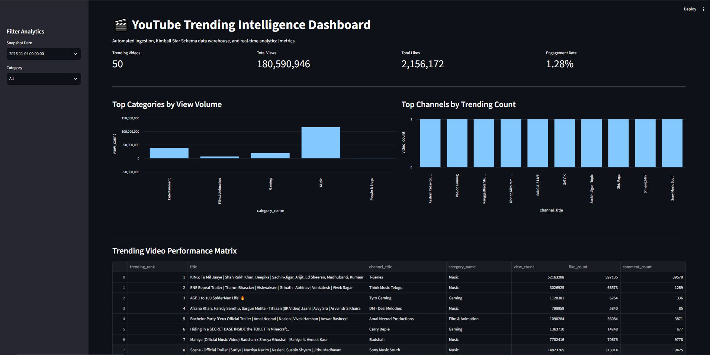

# 🎬 YouTube Trending Intelligence Pipeline

**Python • YouTube Data API v3 • DuckDB • Kimball Star Schema • Streamlit**

[](https://www.python.org/)
[](https://duckdb.org/)
[](https://streamlit.io/)
[](#data-model)

---

## 🎯 Overview

An automated data pipeline that extracts YouTube Trending metadata, validates it
against data quality rules, loads it into a DuckDB star schema, and serves
insights through an interactive Streamlit dashboard.

**Key features**
- Incremental, date-partitioned raw storage in Parquet
- Quality gate that blocks bad data before it reaches the warehouse
- Kimball-style star schema for fast analytical queries
- Interactive dashboard for trending analysis

---

## 🏗️ Architecture

```text
[ YouTube Data API v3 ]
          │
          ▼
[ 01_extract_youtube.py ]  ──>  data/raw/date=YYYY-MM-DD/*.parquet
          │
          ▼
[ 02_validate_data.py ]    ──>  Quality gate (uniqueness, non-nulls, thresholds)
          │
          ▼
[ 03_load_star_schema.py ] ──>  data/warehouse/youtube_analytics.duckdb
          │                     ├── dim_channel
          │                     ├── dim_category
          │                     ├── dim_date
          │                     └── fct_trending_snapshot
          ▼
[ app/dashboard.py ]       ──>  Streamlit dashboard
```

---

## 📊 Dashboard Preview

<div align="center">
  
</div>

---

## 🧱 Data Model

| Table | Type | Grain / Purpose |
|---|---|---|
| `fct_trending_snapshot` | Fact | One row per video per trending date |
| `dim_channel` | Dimension | One row per channel |
| `dim_category` | Dimension | One row per YouTube video category |
| `dim_date` | Dimension | One row per calendar date |

**Measures:** view count, like count, comment count (add whatever you store).

---

## ✅ Data Quality Checks

| Check | Rule |
|---|---|
| Uniqueness | `(video_id, trending_date)` must be unique |
| Non-nulls | `video_id`, `channel_id`, `category_id` cannot be null |
| Thresholds | Row count per run must be above a minimum; counts cannot be negative |

If any check fails, the pipeline stops and nothing is loaded into the warehouse.

---

## 📂 Repository Structure

```text
youtube-trending-pipeline/
├── assets/
│   └── dashboard_preview.png
├── data/
│   ├── raw/                  # Parquet partitions (date=YYYY-MM-DD/)
│   └── warehouse/            # DuckDB database
├── scripts/
│   ├── 01_extract_youtube.py
│   ├── 02_validate_data.py
│   ├── 03_load_star_schema.py
│   └── config.py             # git-ignored; see config.example.py
├── app/
│   └── dashboard.py
├── .gitignore
├── requirements.txt
└── README.md
```

---

## 🚀 Getting Started

### Prerequisites
- Python 3.12+
- A YouTube Data API v3 key ([how to get one](https://developers.google.com/youtube/v3/getting-started))

### Setup
```bash
git clone https://github.com/<your-username>/youtube-trending-pipeline.git
cd youtube-trending-pipeline
python -m venv .venv
source .venv/bin/activate        # Windows: .venv\Scripts\activate
pip install -r requirements.txt
```

### Configure
Copy the example config and add your API key:
```bash
cp scripts/config.example.py scripts/config.py
```
Never commit `config.py` or your API key.

### Run the pipeline
```bash
python scripts/01_extract_youtube.py
python scripts/02_validate_data.py
python scripts/03_load_star_schema.py
```

### Launch the dashboard
```bash
streamlit run app/dashboard.py
```

---

## 🧠 Design Decisions

- **DuckDB:** embedded OLAP engine with no server to run, and it reads Parquet natively.
- **Parquet partitions by date:** immutable raw layer, so you can reload or replay any day.
- **Validation before load:** the warehouse only ever contains data that passed the checks.
- **Star schema:** simple joins and fast aggregations for dashboard queries.

---

## 🔭 Future Improvements

- Schedule daily runs (cron, GitHub Actions, or Airflow)
- Multi-region trending data
- Unit tests and CI
- Dockerfile for one-command setup

---

